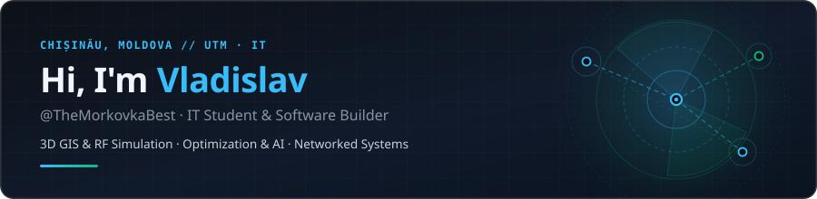

  

  
  

---

## About Me

- 🎓 **IT Student** at **UTM — Universitatea Tehnică a Moldovei** (Chișinău).
- ⚙️ Driven by understanding how computers, networks, and algorithms work under the hood — and turning that curiosity into working software.
- 🛠️ Currently focused on **3D GIS & RF simulation**, **optimization & ML from scratch**, **network engineering tools**, and **applied RAG / AI systems**.

---

## Featured Projects

| Project | Overview | Stack |
| :--- | :--- | :--- |
| **[ZoneOneM](https://github.com/TheMorkovkaBest/ZoneOneM)** | Desktop 3D cellular RF coverage, placement & backhaul engineering workstation. Features deterministic raytraced propagation (COST 231, OSM 3D buildings, ITU-R P.526 Fresnel diffraction, 3GPP sector patterns), three base-station placement optimizers (C99 `POPCNT` bitset greedy set cover, pure-NumPy Dilated FCN + REINFORCE RL surrogate, Hybrid Memetic GA), L1–L3 / PoE / microwave LOS / 5GC backhaul synthesis, SNMPv2c simulation, and water-filling + max-min fair subscriber load testing. | `Python` · `PyQt6` · `MapLibre GL` · `deck.gl` · `NumPy` · `C99` · `SQLite` |
| **[Spott](https://github.com/natankatsif/Spott)** | Multilingual (`RO` / `RU` / `EN`) RAG AI assistant for Chișinău City Hall built in a 4-person team at **DeepTech GigaHack 2026**. Answers questions strictly from public municipal documents and scanned PDFs, backing every sentence with verified citations down to the exact act, page, and clause. | `Python` · `FastAPI` · `Next.js` · `TypeScript` · `PostgreSQL` · `pgvector` · `Docker` |

---

## Tech Stack

| Category | Technologies |
| :--- | :--- |
| **Languages** |       |
| **Desktop, 3D & GIS** |     |
| **AI, Algorithms & Simulation** |    |
| **Web, Data & Tooling** |       |

---

## Connect

- **GitHub:** [@TheMorkovkaBest](https://github.com/TheMorkovkaBest)
- **Steam:** [TheMorkovkaBest](https://steamcommunity.com/profiles/76561199222987636/)
